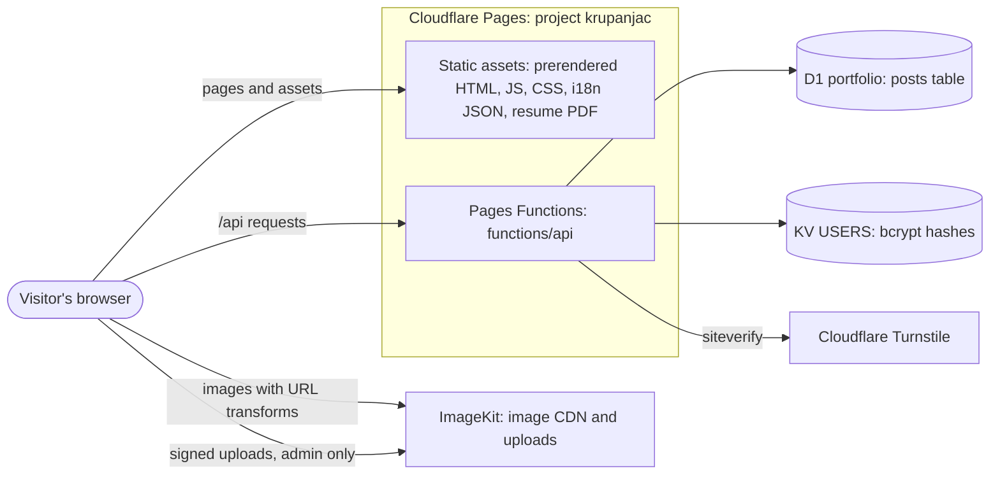
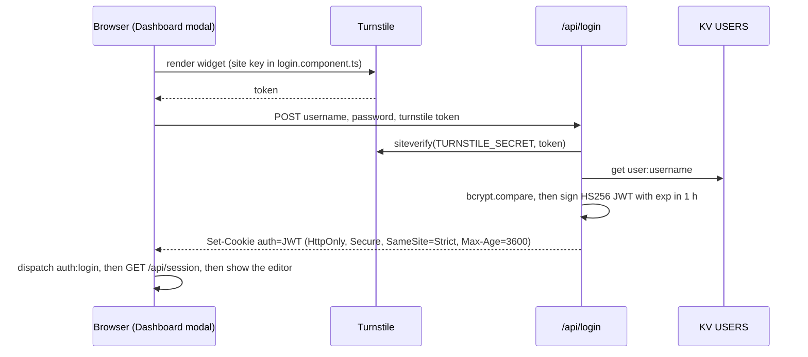

# Architecture

How krupanjac.dev is put together, as of `master` @ `3c1e559` (October 2026). Open work that changes this picture is listed under [Pending changes](#pending-changes). Known problems are in [ROADMAP.md](ROADMAP.md); this file describes what *is*.

- [System overview](#system-overview)
- [Repository layout](#repository-layout)
- [Frontend](#frontend)
- [Backend: Pages Functions](#backend-pages-functions)
- [Data model](#data-model)
- [Build, prerender and hosting](#build-prerender-and-hosting)
- [Quality gates](#quality-gates)
- [Pending changes](#pending-changes)

## System overview

- **The site is static.** `ng build` prerenders the Angular app into HTML at build time, and Cloudflare Pages serves `dist/arsen-portfolio-2025/browser`. No Node server runs in production. `src/server.ts` (Express) only backs `npm run serve:ssr:*` locally and the CLI's dev server.
- **The API is Cloudflare Pages Functions.** Each file in `functions/api/` becomes a route under `/api/`. Bindings come from `wrangler.toml`: `PORTFOLIO` (D1) and `USERS` (KV).
- **Content is a tiny CMS.** The Projects and Experience sections render rows from one D1 table. The owner edits them in a Dashboard modal after logging in.
- **External services:** ImageKit for image storage and resizing, Turnstile as a bot check on login.

## Repository layout

| Path | What lives there |
|---|---|
| `src/main.ts`, `src/app/app.config.ts` | Browser bootstrap: router, animations, `HttpClient` (fetch backend), ngx-translate with an HTTP loader for `/i18n/*.json` |
| `src/main.server.ts`, `src/app/app.config.server.ts`, `src/app/app.routes.server.ts`, `src/server.ts` | Server bootstrap, used only for prerendering and local SSR. Every route is `RenderMode.Prerender` |
| `src/app/app.component.*` | The page itself: an ordered list of `<section id>` blocks, plus overlays |
| `src/app/layout/` | Page chrome shared across sections (nav, hero, background, rail, play button, loader, footer) |
| `src/app/{home,experience,projects,about,contact}/` | One folder per page section |
| `src/app/{admin-editor,login,blog-modal,resume-modal}/` | Dialog content: CMS editor, login form, project viewer, resume viewer |
| `src/app/{admin,blog-list}/`, `auth.guard.ts`, `auth.service.ts` | Routed pages that never render, because there is no router outlet (see below) |
| `src/app/shared/` | Directives and pipes: `appTerminalTyping`, `appTooltip`, `markdown`, `markdownInline` |
| `src/styles.scss` | Tailwind import, theme tokens, helper classes, global rules |
| `src/testing/` | `provideTestDeps()` for component specs |
| `public/` | Copied as-is to the site root: `i18n/`, `_redirects`, `robots.txt`, `sitemap.xml`, `favicon.ico`, `Arsen_Djurdjev_Resume.pdf` |
| `functions/api/` | Pages Functions (Workers runtime) |
| `migrations/` | D1 migrations (`0001_create_posts.sql`) |
| `scripts/` | `check-i18n.mjs` (catalog checker), `gen.js` (bcrypt hash for an admin user) |
| `.claude/`, `AGENTS.md`, `CLAUDE.md`, `GEMINI.md` | Agent harness: instructions, settings, hooks, playbooks |

## Frontend

Angular 19 with standalone components, zone.js change detection, `*ngIf`/`*ngFor` templates, Tailwind CSS v4 and ngx-translate v17.

### Page composition

The router has no outlet: `AppComponent` renders every section directly, in this order.

| # | Anchor | Component | Content comes from |
|---|---|---|---|
| 1 | `#start` | `HeroComponent`, which hosts `BackgroundComponent` (a fixed full-screen canvas behind the whole page) | i18n `HERO.*`, social links in the template |
| 2 | `#home` | `HomeComponent` + `TechStackWheelComponent` | i18n `HOME.*`; tech groups are hardcoded in `tech-stack-wheel.component.ts` |
| 3 | `#resume` | `PlayButtonComponent`. Despite the anchor name, the resume button is in the hero | — |
| 4 | `#experience` | `WorkComponent` (selector `app-experience`, a legacy class name) | D1 posts with `category = 'experience'`, newest first |
| 5 | `#projects` | `ProjectsComponent`, which opens `BlogModalComponent` | D1 posts with `category = 'project'` |
| 6 | `#about` | `AboutComponent`, a terminal-style "whoami" | i18n `ABOUT.*` |
| 7 | `#contact` | `ContactComponent`, a terminal-style contact card | i18n `CONTACT.*`; the address `contact@krupanjac.dev` is in the component |
| — | footer | `FooterComponent` | i18n `FOOTER.*` |

Overlays:

- **Loader:** stays up until `window` `load`, with a 10 s fallback.
- **Resume modal:** the PDF in an `<iframe>`, plus a download link.
- **Dashboard modal:** lives inside `NavComponent`; shows login or the CMS editor.
- **Play mode:** a close button shown only while playing.

**Play mode.** `PlayStateService.isPlaying` hides the nav, every section and the footer, leaving only the hero's background canvas to play with. Controls, from `background.component.ts`:

| Input | Effect |
|---|---|
| `D` | Toggle gravity-drawing mode |
| `Shift`+click (drawing mode) | Start or stop laying gravity points |
| `S` (drawing mode) | Add 20 stars |
| `C` | Clear gravity fields |
| Click | Particle burst |

A help overlay lists these for 3 s after Play is pressed.

### Components worth knowing

| Component | Notes |
|---|---|
| `NavComponent` (`layout/nav`) | Fixed header. Scroll-spy uses an `IntersectionObserver` over every `section[id]`. Smooth scrolling is its own rAF ease that stops on wheel/touch/key input. Language toggle (en/sr) has a 1 s cooldown and is saved in `localStorage.lang`. Theme toggle sets `data-theme` on `<html>` (dark by default) and saves it in `localStorage.theme`. Hosts the Dashboard modal and checks the session with a direct `fetch('/api/session')`. Also has an unused `onLogin()` |
| `HeroComponent` | Name "glitch": every 1 s, two letters of "Đurđev" are retyped as symbols and restored. Also social links, the resume button (emits `openResumeModal`) and a scroll indicator |
| `BackgroundComponent` | 837-line 2D canvas: star field with O(n²) connection lines, mouse attraction, click particles, and play-mode gravity drawing. Re-reads the accent colour from CSS periodically so it follows the theme |
| `TechStackWheelComponent` | Six groups on a ring (languages, frameworks, platform, tooling, AI, creative). Choosing one spawns its items as bodies in a small physics simulation driven by rAF. Labels come from `HOME.STACK.GROUPS.*.TITLE` and `HOME.STACK.ITEMS.<KEY>` |
| `BlogModalComponent` | Project viewer: image carousel with ImageKit `srcset`, `Esc` and arrow keys, swipe, and the markdown description |
| `AboutComponent` | Uses an `IntersectionObserver` to start a staggered `triggerTyping()` across every typing directive in the section, 120 ms apart |
| `AdminEditorComponent` | CRUD for posts. Tags are entered as comma-separated text; category is a select; `created_at` is a `datetime-local` stored as epoch seconds; multiple images upload to ImageKit; markdown preview. Experience posts drop their images on save |
| `LoginComponent` | Injects the Turnstile script on demand (the site key is hardcoded) and keeps submit disabled until a token arrives. On success it fires a `window` `auth:login` event, which the nav listens for, and navigates to `/admin`, which ends up back at `/` (see below) |

### Routing (vestigial)

`app.routes.ts` declares `''`, `projects`, `experience`, `about`, `blog`, `contact`, `admin` (behind `authGuard`), `resume`, `cv` and `**`, but no template contains `<router-outlet>`. As a result:

- every route renders the same single page: the seven page routes are prerendered as byte-identical HTML files (`/cv` and `/resume` are redirects and produce none);
- `AdminComponent`, `BlogListComponent`, `authGuard` and `AuthService` never take effect, and the CMS really lives in the nav's Dashboard modal;
- `/resume` and `/cv` are served by `public/_redirects` as 301s to the PDF before Angular is involved.

### Shared building blocks

| Piece | Behaviour |
|---|---|
| `appTerminalTyping` | When the language changes, erases and retypes the element's text with a cursor. If the element has `data-i18n-key`, it reads the new translation from `TranslateService` directly, so it doesn't race the pipe. `triggerTyping(text)` is a one-shot reveal (used by About). It works through `innerHTML` |
| `appTooltip` | Appends a fixed-position bubble to `<body>` on hover or focus and toggles it on touch. Translates its text if it looks like a key. Injects its CSS once. Sets `tabindex="0"` on its host and listens to window scroll/resize events on every instance |
| `markdown` / `markdownInline` pipes | `marked` (GFM, `breaks: true`), then DOMPurify in the browser. On the server only a regex strip runs, which is weaker, so it doesn't matter today only because posts never render on the server |
| `safeUrl` pipe | `bypassSecurityTrustResourceUrl`. Only used for the static resume path |

### Services

| Service | Role |
|---|---|
| `BlogService` | `GET/POST/PUT/DELETE /api/posts`. Projects and Experience each call `list()`, so one page load makes two identical requests |
| `ImagekitService` | Builds transformation URLs (preview, responsive `srcset`, modal sizes) and uploads with signed parameters from `/api/imagekit-auth`. The public key and URL endpoint are hardcoded |
| `PlayStateService` | `BehaviorSubject<boolean>` for play mode |
| `LoginService` | `POST /api/login` with the Turnstile token |
| `AuthService` | Session check through `HttpClient`. Only used by the unreachable guard |

### Styling and theming

- **Tailwind v4** comes in through PostCSS (`.postcssrc.json`) and `@use "tailwindcss"` in `src/styles.scss`. There's no `tailwind.config`, and no `@theme` block.
- **Theme tokens** are CSS custom properties: light values on `:root`, dark values on `:root[data-theme='dark']`. They are `--color-bg`, `--color-surface`, `--color-text`, `--color-accent`, `--color-accent-rgb` and friends.
- **Hand-written helpers** turn tokens into classes, all with `!important`: `.text-accent`, `.text-primary`, `.text-secondary`, `.text-muted`, `.text-faint`, `.bg-surface`, `.bg-surface-alt`, `.border-base`, `.border-divider`, `.rail-separator`. Because Tailwind never sees the tokens, utilities such as `bg-accent/80`, `ring-accent` or `from-surface/70` silently produce nothing (ROADMAP BUG-1).
- **Global rules:** `user-select: none` on `html, body`, `a { cursor: default }`, and hidden scrollbars. The `Open Sans` font family is declared but never loaded.
- **Section layout:** a two-column grid, a 20 % `RailComponent` label column plus content, which collapses to a single column with a mobile label below `md`.

### Internationalisation

- ngx-translate v17 with `TranslateHttpLoader` (`/i18n/{lang}.json`). Default `en`; the choice is saved in `localStorage.lang`. `<html lang>` stays `en`.
- `public/i18n/en.json` and `sr.json` hold 153 keys each, grouped `NAV`, `HERO`, `HOME`, `ABOUT`, `CONTACT`, `PROJECTS`, `EXPERIENCE`, `PLAY`, `HELP`, `LOGIN`, `RESUME`, `TOOLTIP`, `FOOTER`. Serbian is Latin script. Section labels use a terminal motif (`Kontakt/>`, `Projekti/`).
- `npm run check:i18n` enforces parity, non-empty values, matching `{{params}}`, and that every key used in `src/` exists. It warns about unused keys (50 today). Keys built at runtime (`HOME.STACK.ITEMS.` + key) are allowed for in `DYNAMIC_PREFIXES`.

### Platform guards

The app is prerendered, so all browser access is guarded with `isPlatformBrowser(PLATFORM_ID)` or `typeof window !== 'undefined'`. On the server, `AppComponent` turns the loader off, and Projects and Experience skip their fetch. That's why the prerendered HTML contains real translated copy but **no projects or experience entries**.

## Backend: Pages Functions

File-based routing: `functions/api/<name>.js` handles `/api/<name>`. `_middleware.js` runs before every `/api/*` request.

| Endpoint | Auth | Behaviour |
|---|---|---|
| `GET /api/session` | public | `{ authenticated, username }`, read from the `auth` cookie |
| `POST /api/login` | public, needs a Turnstile token | Checks the token with Turnstile `siteverify`, looks up `user:<username>` in KV, `bcrypt.compare`s the password, and sets the `auth` cookie |
| `POST /api/logout` | a valid cookie (the middleware requires one) | Clears the cookie |
| `GET /api/posts`, `GET /api/posts?id=` | public | Lists posts (`ORDER BY created_at DESC`) or returns one. `tags` and `images` are parsed from JSON |
| `POST`, `PUT`, `DELETE /api/posts` | JWT | Create; update (by `id` in the body); delete (by `?id=`) |
| `POST /api/imagekit-auth` | JWT | Returns `{ token, signature, expire }` (HMAC-SHA1 with `IMAGEKIT_PRIVATE_KEY`) for a direct browser upload |
| `GET /api/admin` | JWT | Sample protected endpoint; the UI doesn't use it |

### Authentication

- JWTs are hand-rolled on WebCrypto (`signJWT`/`verifyJWT` in `login.js`): HS256 with only `username` and `exp` claims. There's no server-side session list, so logging out only deletes the cookie.
- **Middleware.** It lets through the public prefixes (`/api/login`, `/api/session`, a list of page paths), static-file extensions and every `GET /api/posts*`. Everything else needs a valid cookie. `posts.js` and `imagekit-auth.js` check the token again themselves.
- **Admin users** are KV entries `user:<name>` → bcrypt hash, made with `node scripts/gen.js '<password>'` (see DEVELOPMENT.md).

### Configuration and secrets

| Name | Kind | Where it's set |
|---|---|---|
| `PORTFOLIO` | D1 binding (database `portfolio`) | `wrangler.toml` |
| `USERS` | KV binding | `wrangler.toml` |
| `JWT_SECRET` | secret | Cloudflare Pages environment variables; `.dev.vars` locally |
| `TURNSTILE_SECRET` | secret | same |
| `IMAGEKIT_PRIVATE_KEY` | secret | same |
| Turnstile site key | public | hardcoded in `login.component.ts` |
| ImageKit public key and URL endpoint | public | hardcoded in `imagekit.service.ts` |

## Data model

One table, defined in `migrations/0001_create_posts.sql`. The same DDL is also copied into `functions/db/init_posts.sql` and inlined in `posts.js` (`initializeDatabase`, which runs on every request).

| Column | Type | Notes |
|---|---|---|
| `id` | INTEGER PK AUTOINCREMENT | |
| `title` | TEXT NOT NULL | |
| `description` | TEXT | Markdown |
| `tags` | TEXT | JSON array of strings |
| `images` | TEXT | JSON array of URLs, usually ImageKit |
| `category` | TEXT | `'project'` or `'experience'`, not enforced |
| `created_by`, `updated_by` | TEXT | Username taken from the JWT |
| `created_at`, `updated_at` | INTEGER | Epoch **seconds**; `created_at` can be edited and doubles as the display date |

The frontend type is `BlogPost` in `blog.service.ts`.

## Build, prerender and hosting

- `npm run build` (`ng build`, production) writes:
  - `dist/arsen-portfolio-2025/browser/`: static files plus prerendered HTML. Nine routes are prerendered (`prerendered-routes.json`); the seven page routes `/`, `/about`, `/admin`, `/blog`, `/contact`, `/experience` and `/projects` each get an `index.html`, all byte-identical because there's no router outlet. `/cv` and `/resume` are redirects and produce no file.
  - `dist/arsen-portfolio-2025/server/`: the SSR bundle, unused in production.
- **Budgets:** the initial bundle warns at 500 kB and fails at 1 MB. Today it's 733 kB raw, about 181 kB over the wire. Component styles warn at 4 kB.
- **No hydration.** `provideClientHydration` isn't configured, so the browser discards the prerendered DOM and renders again. The prerendered `<html>` has no `data-theme`, so the first paint uses the light tokens before the nav switches to dark.
- **Cloudflare Pages:** project `krupanjac`, built by the Pages Git integration. The output directory is `pages_build_output_dir` in `wrangler.toml`. Every branch gets a preview at `<branch>.krupanjac.pages.dev`. There is no deploy workflow in this repo.
- `public/_redirects` has pass-through rules for static types, 301s for `/resume` and `/cv` to the PDF, and a SPA fallback `/* / 200`.
- **SEO files:**
  - `robots.txt` blocks AI crawlers and `/admin`.
  - `sitemap.xml` lists `/` and the PDF.
  - Open Graph and Twitter tags live in `src/index.html`; `og:image` is `favicon.ico`.

## Quality gates

| Gate | What it catches |
|---|---|
| `npm run check:i18n` | Locale parity, empty values, `{{param}}` mismatches, keys used but not defined |
| `npm run test:ci` | 15 Jasmine tests across 12 spec files, in headless Chrome: smoke "creates" tests plus the play-button timing test. Specs use `provideTestDeps()` |
| `npm run build` | Template type checks (`strictTemplates`), budgets, and SSR-unsafe code (prerender runs in Node) |
| `npm run verify` | All three, in that order. CI (`.github/workflows/ci.yml`) runs it on every PR and on pushes to `master` |
| Claude Code hook | `.claude/hooks/post-edit.mjs` runs the i18n check after each edit |

There is no linter, formatter, e2e or visual test yet (ROADMAP DX-2, DX-7).

## Pending changes

**PR #8, "rendering-first rebuild"** (`wonder/Sottsass`, open since 2026-09-10, fast-forwards onto `master`). If merged, this document needs these updates:

- **Removed:** `BackgroundComponent` and the star-field play mode with its D/C/S/click controls.
- **Added:**
  - `src/app/gfx/`: a framework-agnostic WebGL2 renderer covering context and capability probe, shader compile, frame timer with GPU timer queries, dynamic resolution scaler, render loop, and shader surface with context-loss recovery.
  - `layout/hero-render/`: a raymarched terrain hero plus a contour-field shader behind the sections, crossfaded on scroll, with a frame-time HUD.
  - Fullscreen renderer mode: `1`/`2`/`3` pin the resolution, `A` returns to auto, `Esc` exits.
- **Restyled:**
  - Fonts: Space Grotesk, IBM Plex Sans and JetBrains Mono from Google Fonts, exposed as `--font-*` tokens.
  - A darker dark palette, a global `:focus-visible` ring and a global reduced-motion rule.
  - Redesigned nav, home, about and contact, and designed empty states for Projects and Experience.
- **Unchanged:** routing, `functions/`, `wrangler.toml`, the data model, and the missing `@theme` (BUG-1).
- **i18n:** grows from 153 to 175 keys with full parity.

Review notes and the merge plan are in [ROADMAP.md, Phase 1](ROADMAP.md#phase-1-land-pr-8-safely).
