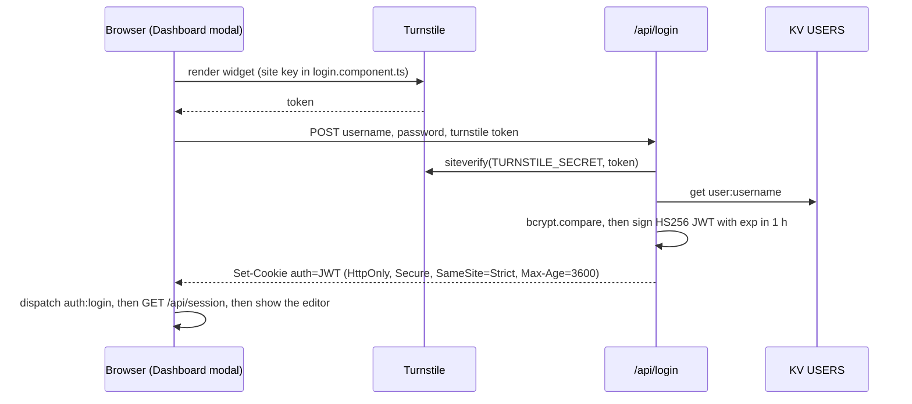

# Architecture

How krupanjac.dev is put together (October 2026, including PR #8's WebGL2 renderer). Known problems are in [ROADMAP.md](ROADMAP.md); this file describes what *is*.

- [System overview](#system-overview)
- [Repository layout](#repository-layout)
- [Frontend](#frontend)
- [Backend: Pages Functions](#backend-pages-functions)
- [Data model](#data-model)
- [Build, prerender and hosting](#build-prerender-and-hosting)
- [Quality gates](#quality-gates)
- [History](#history)

## System overview

- **The site is static.** `ng build` prerenders the Angular app into HTML at build time, and Cloudflare Pages serves `dist/arsen-portfolio-2025/browser`. No Node server runs in production. `src/server.ts` (Express) only backs `npm run serve:ssr:*` locally and the CLI's dev server.
- **The API is Cloudflare Pages Functions.** Each file in `functions/api/` becomes a route under `/api/`. Bindings come from `wrangler.toml`: `PORTFOLIO` (D1) and `USERS` (KV).
- **Content is a tiny CMS.** The Projects and Experience sections render rows from one D1 table. The owner edits them in a Dashboard modal after logging in.
- **External services:** ImageKit for image storage and resizing, Turnstile as a bot check on login.

## Repository layout

| Path | What lives there |
|---|---|
| `src/main.ts`, `src/app/app.config.ts` | Browser bootstrap: router, animations, `HttpClient` (fetch backend), ngx-translate with an HTTP loader for `/i18n/*.json` |
| `src/main.server.ts`, `src/app/app.config.server.ts`, `src/app/app.routes.server.ts`, `src/server.ts` | Server bootstrap, used only for prerendering and local SSR. Every route is `RenderMode.Prerender` |
| `src/app/app.component.*` | The page itself: an ordered list of `<section id>` blocks, plus overlays |
| `src/app/layout/` | Page chrome shared across sections (nav, hero, hero render stage, rail, play button, loader, footer) |
| `src/app/gfx/` | The WebGL2 renderer: engine classes, two Angular wrappers, shaders and the palette (see [Renderer](#renderer)) |
| `src/app/{home,experience,projects,about,contact}/` | One folder per page section |
| `src/app/{admin-editor,login,blog-modal,resume-modal}/` | Dialog content: CMS editor, login form, project viewer, resume viewer |
| `src/app/{admin,blog-list}/`, `auth.guard.ts`, `auth.service.ts` | Routed pages that never render, because there is no router outlet (see below) |
| `src/app/shared/` | Directives and pipes: `appTerminalTyping`, `appTooltip`, `markdown`, `markdownInline` |
| `src/styles.scss` | Tailwind import, theme tokens, helper classes, global rules |
| `src/testing/` | `provideTestDeps()` for component specs |
| `public/` | Copied as-is to the site root: `i18n/`, `_redirects`, `robots.txt`, `sitemap.xml`, `favicon.ico`, `Arsen_Djurdjev_Resume.pdf` |
| `functions/api/` | Pages Functions (Workers runtime) |
| `migrations/` | D1 migrations (`0001_create_posts.sql`) |
| `scripts/` | `check-i18n.mjs` (catalog checker), `gen.js` (bcrypt hash for an admin user) |
| `.claude/`, `AGENTS.md`, `CLAUDE.md`, `GEMINI.md` | Agent harness: instructions, settings, hooks, playbooks |

## Frontend

Angular 19 with standalone components, zone.js change detection, `*ngIf`/`*ngFor` templates, Tailwind CSS v4 and ngx-translate v17.

### Page composition

The router has no outlet: `AppComponent` renders every section directly, in this order.

| # | Anchor | Component | Content comes from |
|---|---|---|---|
| 1 | `#start` | `HeroComponent`, which mounts `HeroRenderComponent`: a fixed full-viewport WebGL2 stage behind the whole page | i18n `HERO.*`, social links in the template |
| 2 | `#home` | `HomeComponent` + `TechStackWheelComponent` | i18n `HOME.*`; tech groups are hardcoded in `tech-stack-wheel.component.ts` |
| 3 | `#resume` | `PlayButtonComponent`, the **Fullscreen renderer** control. Despite the anchor name, the resume button is in the hero | — |
| 4 | `#experience` | `WorkComponent` (selector `app-experience`, a legacy class name) | D1 posts with `category = 'experience'`, newest first |
| 5 | `#projects` | `ProjectsComponent`, which opens `BlogModalComponent` | D1 posts with `category = 'project'` |
| 6 | `#about` | `AboutComponent`, a terminal-style "whoami" | i18n `ABOUT.*` |
| 7 | `#contact` | `ContactComponent`, a terminal-style contact card | i18n `CONTACT.*`; the address `contact@krupanjac.dev` is in the component |
| — | footer | `FooterComponent` | i18n `FOOTER.*` |

Overlays:

- **Loader:** stays up until `window` `load`, with a 10 s fallback.
- **Resume modal:** the PDF in an `<iframe>`, plus a download link.
- **Dashboard modal:** lives inside `NavComponent`; shows login or the CMS editor.
- **Fullscreen renderer:** a close button shown only in that mode.

**Fullscreen renderer.** `PlayStateService.isPlaying` hides the nav, every section and the footer, leaving the renderer and its HUD. Controls, handled in `hero-render.component.ts`:

| Input | Effect |
|---|---|
| Pointer | Look around |
| `1` / `2` / `3` | Pin the internal resolution at 50 / 75 / 100 % |
| `A` (or `0`) | Hand resolution back to the dynamic scaler |
| Click the HUD readout | Expand GPU time, p95 and fill rate |
| `Esc` | Leave fullscreen |

A help overlay lists these for 3 s after the control is pressed.

### Components worth knowing

| Component | Notes |
|---|---|
| `NavComponent` (`layout/nav`) | Fixed header. Scroll-spy uses an `IntersectionObserver` over every `section[id]`. Smooth scrolling is its own rAF ease that stops on wheel/touch/key input. Language toggle (en/sr) has a 1 s cooldown and is saved in `localStorage.lang`. Theme toggle sets `data-theme` on `<html>` (dark by default) and saves it in `localStorage.theme`. Hosts the Dashboard modal and checks the session with a direct `fetch('/api/session')`. Also has an unused `onLogin()` |
| `HeroComponent` | Name scramble: every 2.6 s one glyph of "Đurđev" flips briefly. Also the discipline line, social links, the resume button (emits `openResumeModal`) and a scroll hint. Mounts the render stage |
| `HeroRenderComponent` (`layout/hero-render`) | The stage: terrain surface, contour-field surface and frame HUD. Smooths pointer and scroll input, re-reads the palette when `data-theme` changes, parks the terrain past 1.35 viewport heights, fades into the page through the `--stage-veil` CSS variable, and owns the fullscreen keys |
| `GpuSurfaceComponent` (`gfx/gpu-surface`) | Wraps one `ShaderSurface` on a canvas, outside Angular's zone. Emits `ready` (capabilities), `stats` (about 6 times a second) and `failed` |
| `FrameHudComponent` (`gfx/frame-hud`) | Live frame time, FPS and a frame-history graph from the terrain surface; click to expand |
| `TechStackWheelComponent` | Six groups on a ring (languages, frameworks, platform, tooling, AI, creative). Choosing one spawns its items as bodies in a small physics simulation driven by rAF. Labels come from `HOME.STACK.GROUPS.*.TITLE` and `HOME.STACK.ITEMS.<KEY>` |
| `BlogModalComponent` | Project viewer: image carousel with ImageKit `srcset`, `Esc` and arrow keys, swipe, and the markdown description |
| `AboutComponent` | Uses an `IntersectionObserver` to start a staggered `triggerTyping()` across every typing directive in the section, 120 ms apart |
| `AdminEditorComponent` | CRUD for posts. Tags are entered as comma-separated text; category is a select; `created_at` is a `datetime-local` stored as epoch seconds; multiple images upload to ImageKit; markdown preview. Experience posts drop their images on save |
| `LoginComponent` | Injects the Turnstile script on demand (the site key is hardcoded) and keeps submit disabled until a token arrives. On success it fires a `window` `auth:login` event, which the nav listens for, and navigates to `/admin`, which ends up back at `/` (see below) |

### Routing (vestigial)

`app.routes.ts` declares `''`, `projects`, `experience`, `about`, `blog`, `contact`, `admin` (behind `authGuard`), `resume`, `cv` and `**`, but no template contains `<router-outlet>`. As a result:

- every route renders the same single page: the seven page routes are prerendered as byte-identical HTML files (`/cv` and `/resume` are redirects and produce none);
- `AdminComponent`, `BlogListComponent`, `authGuard` and `AuthService` never take effect, and the CMS really lives in the nav's Dashboard modal;
- `/resume` and `/cv` are served by `public/_redirects` as 301s to the PDF before Angular is involved.

### Shared building blocks

| Piece | Behaviour |
|---|---|
| `appTerminalTyping` | When the language changes, erases and retypes the element's text with a cursor. If the element has `data-i18n-key`, it reads the new translation from `TranslateService` directly, so it doesn't race the pipe. `triggerTyping(text)` is a one-shot reveal (used by About). It works through `innerHTML` |
| `appTooltip` | Appends a fixed-position bubble to `<body>` on hover or focus and toggles it on touch. Translates its text if it looks like a key. Injects its CSS once. Sets `tabindex="0"` on its host and listens to window scroll/resize events on every instance |
| `markdown` / `markdownInline` pipes | `marked` (GFM, `breaks: true`), then DOMPurify in the browser. On the server only a regex strip runs, which is weaker, so it doesn't matter today only because posts never render on the server |
| `safeUrl` pipe | `bypassSecurityTrustResourceUrl`. Only used for the static resume path |

### Services

| Service | Role |
|---|---|
| `BlogService` | `GET/POST/PUT/DELETE /api/posts`. Projects and Experience each call `list()`, so one page load makes two identical requests |
| `ImagekitService` | Builds transformation URLs (preview, responsive `srcset`, modal sizes) and uploads with signed parameters from `/api/imagekit-auth`. The public key and URL endpoint are hardcoded |
| `PlayStateService` | `BehaviorSubject<boolean>` for play mode |
| `LoginService` | `POST /api/login` with the Turnstile token |
| `AuthService` | Session check through `HttpClient`. Only used by the unreachable guard |

### Styling and theming

- **Tailwind v4** comes in through PostCSS (`.postcssrc.json`) and `@use "tailwindcss"` in `src/styles.scss`. There's no `tailwind.config`, and no `@theme` block.
- **Theme tokens** are CSS custom properties: light values on `:root`, dark values on `:root[data-theme='dark']`. They are `--color-bg`, `--color-surface`, `--color-text`, `--color-accent`, `--color-accent-rgb` and friends.
- **Hand-written helpers** turn tokens into classes, all with `!important`: `.text-accent`, `.text-primary`, `.text-secondary`, `.text-muted`, `.text-faint`, `.bg-surface`, `.bg-surface-alt`, `.border-base`, `.border-divider`, `.rail-separator`. Because Tailwind never sees the tokens, utilities such as `bg-accent/80`, `ring-accent` or `from-surface/70` silently produce nothing (ROADMAP BUG-1).
- **Type:** Space Grotesk (display), IBM Plex Sans (body) and JetBrains Mono (measurements, paths) from Google Fonts, exposed as `--font-display`, `--font-body` and `--font-mono`.
- **Renderer palette:** the `--gfx-*` tokens, also in `src/styles.scss` (see [Renderer](#renderer)).
- **Theme rules inside component stylesheets** must use `:host-context(html[data-theme='dark'])` / `:host-context(html:not([data-theme='dark']))`. A `:root[...] .x` selector never matches there, because emulated encapsulation tags the `:root` compound with the component attribute; that's how the hero's light-theme scrim was silently dead.
- **Global rules:** `user-select: none` on `html, body`, `a { cursor: default }`, and hidden scrollbars.
- **Section layout:** a two-column grid, a 20 % `RailComponent` label column plus content, which collapses to a single column with a mobile label below `md`.

### Internationalisation

- ngx-translate v17 with `TranslateHttpLoader` (`/i18n/{lang}.json`). Default `en`; the choice is saved in `localStorage.lang`. `<html lang>` stays `en`.
- `public/i18n/en.json` and `sr.json` hold 153 keys each, grouped `NAV`, `HERO`, `HOME`, `ABOUT`, `CONTACT`, `PROJECTS`, `EXPERIENCE`, `PLAY`, `HELP`, `LOGIN`, `RESUME`, `TOOLTIP`, `FOOTER`. Serbian is Latin script. Section labels use a terminal motif (`Kontakt/>`, `Projekti/`).
- `npm run check:i18n` enforces parity, non-empty values, matching `{{params}}`, and that every key used in `src/` exists. It warns about unused keys (50 today). Keys built at runtime (`HOME.STACK.ITEMS.` + key) are allowed for in `DYNAMIC_PREFIXES`.

### Renderer

`src/app/gfx/` is a small WebGL2 engine with no dependencies. The core classes know nothing about Angular; two thin components wrap them.

| Piece | Role |
|---|---|
| `gl-context.ts` | Creates the WebGL2 context and probes the GPU: name, timer queries, float render targets |
| `shader.ts` | Compiles and links, quoting the failing source line in errors. `setAll()` ignores uniforms a shader doesn't declare |
| `fullscreen-pass.ts` | The full-screen vertex stage every surface draws with |
| `frame-timer.ts` | CPU and GPU frame time (`EXT_disjoint_timer_query_webgl2`), with p95 and worst over a 120-frame ring |
| `resolution-scaler.ts` | Dynamic resolution between 45 % and 100 % in 5 % steps |
| `render-loop.ts` | The rAF driver. It runs only while the page is visible, the canvas is in view, and the caller hasn't parked it |
| `shader-surface.ts` | One full-screen fragment pass with all of the above, plus resize handling and context-loss recovery |
| `color.ts`, `palette.ts` | CSS colour parsing; `readPalette()` turns the `--gfx-*` tokens into linear-space uniforms |
| `shaders/` | `common.glsl.ts` (hashes, value noise with derivatives, eroded and ridged fBm, ACES, dithering), `hero-terrain.frag.ts`, `contour-field.frag.ts` |

**Two surfaces.**

- **The terrain** is a raymarched, eroded heightfield. Every height query goes through one function: a broad noise tap bends the ranges and adds crest lines, then eroded fBm adds the detail. Valleys below `WATER_LEVEL` flood with a plane that mirrors the sky.
  - Dark theme: a violet-hour dusk.
  - Light theme: a pastel dawn.
  - The two themes are separate lighting setups blended by `uTheme`, not one image filtered.
- **The contour field** runs behind the content sections once the reader leaves the hero. It's a drifting survey map, eleven noise taps a pixel at a fixed 70 % scale, drawn as premultiplied ink over the CSS page background.

**Palette.** All scene colour comes from these tokens in `src/styles.scss`. The shaders never hardcode a hue.

| Token | Dark | Light | Drives |
|---|---|---|---|
| `--gfx-sky-zenith` | `#0b1233` | `#a9b6f2` | Sky overhead; cool fill on up-facing rock |
| `--gfx-sky-horizon` | `#3b2a78` | `#ece6fb` | Horizon haze, the distance fog, the fill on vertical faces |
| `--gfx-sky-glow` | `#f472b6` | `#f7b8d2` | Glow around the sun, cloud rims, rock rim light, relief tint in the field |
| `--gfx-sun` | `#ffc89a` | `#fff1dc` | Sun disk and key light |
| `--gfx-rock-low` / `-high` | `#1a2147` / `#8b7c85` | `#ada1d4` / `#f1ebe5` | Rock albedo from valley floor to ridge |
| `--gfx-rock-strata` | `#b56f7e` | `#e9b9c9` | Sediment bands on steep faces |
| `--gfx-mist` | `#4b3fb0` | `#f1ecfb` | Valley mist |
| `--gfx-ink` / `-alt` | accent-alt / `#f9a8d4` | accent / `#a23b72` | Contour ink from low to high ground, in the hero and the field |

How the frame divides the colour: warm toward the sun, cool away from it and in the distance. The key light is warm and the sky fill cool, so lit ridges and shadowed faces separate by hue as well as by value. `palette.ts` keeps its fallbacks in step with the tokens; change both together.

**Cost and quality.** `uQuality = (renderScale − 0.45) / 0.55` sets the cost knobs:

- march steps scale from 56 to 150, shadow steps from 6 to 20, and terrain detail octaves from 5 to 8;
- shadows switch off below 0.3, mist below 0.25, and clouds below 0.35.

**Parking.** The terrain parks once the reader is past 1.35 viewport heights. The field runs only while the veil is visible. Parking (the caller's intent), the canvas being in view and tab visibility are separate conditions; all three must allow a frame.

**Fallback.** When WebGL2 is missing or a shader fails to compile, `.stage--fallback` paints a CSS gradient that matches the scene. The hero copy stays legible either way.

### Platform guards

The app is prerendered, so all browser access is guarded with `isPlatformBrowser(PLATFORM_ID)` or `typeof window !== 'undefined'`. On the server, `AppComponent` turns the loader off, and Projects and Experience skip their fetch. That's why the prerendered HTML contains real translated copy but **no projects or experience entries**.

## Backend: Pages Functions

File-based routing: `functions/api/<name>.js` handles `/api/<name>`. `_middleware.js` runs before every `/api/*` request.

| Endpoint | Auth | Behaviour |
|---|---|---|
| `GET /api/session` | public | `{ authenticated, username }`, read from the `auth` cookie |
| `POST /api/login` | public, needs a Turnstile token | Checks the token with Turnstile `siteverify`, looks up `user:<username>` in KV, `bcrypt.compare`s the password, and sets the `auth` cookie |
| `POST /api/logout` | a valid cookie (the middleware requires one) | Clears the cookie |
| `GET /api/posts`, `GET /api/posts?id=` | public | Lists posts (`ORDER BY created_at DESC`) or returns one. `tags` and `images` are parsed from JSON |
| `POST`, `PUT`, `DELETE /api/posts` | JWT | Create; update (by `id` in the body); delete (by `?id=`) |
| `POST /api/imagekit-auth` | JWT | Returns `{ token, signature, expire }` (HMAC-SHA1 with `IMAGEKIT_PRIVATE_KEY`) for a direct browser upload |
| `GET /api/admin` | JWT | Sample protected endpoint; the UI doesn't use it |

### Authentication

- JWTs are hand-rolled on WebCrypto (`signJWT`/`verifyJWT` in `login.js`): HS256 with only `username` and `exp` claims. There's no server-side session list, so logging out only deletes the cookie.
- **Middleware.** It lets through the public prefixes (`/api/login`, `/api/session`, a list of page paths), static-file extensions and every `GET /api/posts*`. Everything else needs a valid cookie. `posts.js` and `imagekit-auth.js` check the token again themselves.
- **Admin users** are KV entries `user:<name>` → bcrypt hash, made with `node scripts/gen.js '<password>'` (see DEVELOPMENT.md).

### Configuration and secrets

| Name | Kind | Where it's set |
|---|---|---|
| `PORTFOLIO` | D1 binding (database `portfolio`) | `wrangler.toml` |
| `USERS` | KV binding | `wrangler.toml` |
| `JWT_SECRET` | secret | Cloudflare Pages environment variables; `.dev.vars` locally |
| `TURNSTILE_SECRET` | secret | same |
| `IMAGEKIT_PRIVATE_KEY` | secret | same |
| Turnstile site key | public | hardcoded in `login.component.ts` |
| ImageKit public key and URL endpoint | public | hardcoded in `imagekit.service.ts` |

## Data model

One table, defined in `migrations/0001_create_posts.sql`. The same DDL is also copied into `functions/db/init_posts.sql` and inlined in `posts.js` (`initializeDatabase`, which runs on every request).

| Column | Type | Notes |
|---|---|---|
| `id` | INTEGER PK AUTOINCREMENT | |
| `title` | TEXT NOT NULL | |
| `description` | TEXT | Markdown |
| `tags` | TEXT | JSON array of strings |
| `images` | TEXT | JSON array of URLs, usually ImageKit |
| `category` | TEXT | `'project'` or `'experience'`, not enforced |
| `created_by`, `updated_by` | TEXT | Username taken from the JWT |
| `created_at`, `updated_at` | INTEGER | Epoch **seconds**; `created_at` can be edited and doubles as the display date |

The frontend type is `BlogPost` in `blog.service.ts`.

## Build, prerender and hosting

- `npm run build` (`ng build`, production) writes:
  - `dist/arsen-portfolio-2025/browser/`: static files plus prerendered HTML. Nine routes are prerendered (`prerendered-routes.json`); the seven page routes `/`, `/about`, `/admin`, `/blog`, `/contact`, `/experience` and `/projects` each get an `index.html`, all byte-identical because there's no router outlet. `/cv` and `/resume` are redirects and produce no file.
  - `dist/arsen-portfolio-2025/server/`: the SSR bundle, unused in production.
- **Budgets:** the initial bundle warns at 500 kB and fails at 1 MB. Today it's 733 kB raw, about 181 kB over the wire. Component styles warn at 4 kB.
- **No hydration.** `provideClientHydration` isn't configured, so the browser discards the prerendered DOM and renders again. The prerendered `<html>` has no `data-theme`, so the first paint uses the light tokens before the nav switches to dark.
- **Cloudflare Pages:** project `krupanjac`, built by the Pages Git integration. The output directory is `pages_build_output_dir` in `wrangler.toml`. Every branch gets a preview at `<branch>.krupanjac.pages.dev`. There is no deploy workflow in this repo.
- `public/_redirects` has pass-through rules for static types, 301s for `/resume` and `/cv` to the PDF, and a SPA fallback `/* / 200`.
- **SEO files:**
  - `robots.txt` blocks AI crawlers and `/admin`.
  - `sitemap.xml` lists `/` and the PDF.
  - Open Graph and Twitter tags live in `src/index.html`; `og:image` is `favicon.ico`.

## Quality gates

| Gate | What it catches |
|---|---|
| `npm run check:i18n` | Locale parity, empty values, `{{param}}` mismatches, keys used but not defined |
| `npm run test:ci` | 15 Jasmine tests across 12 spec files, in headless Chrome: smoke "creates" tests plus the play-button timing test. Specs use `provideTestDeps()` |
| `npm run build` | Template type checks (`strictTemplates`), budgets, and SSR-unsafe code (prerender runs in Node) |
| `npm run verify` | All three, in that order. CI (`.github/workflows/ci.yml`) runs it on every PR and on pushes to `master` |
| Claude Code hook | `.claude/hooks/post-edit.mjs` runs the i18n check after each edit |

There is no linter, formatter, e2e or visual test yet (ROADMAP DX-2, DX-7).

## History

- **2026-09/10, PR #8 ("rendering-first rebuild"):**
  - Replaced the 2D star-field background and its D/C/S/click play mode with the WebGL2 renderer and the fullscreen renderer mode.
  - Added the type system (Space Grotesk, IBM Plex Sans, JetBrains Mono), an inkier dark palette, and redesigned nav, home, about and contact, with designed empty states.
  - Before merging, its review findings (ROADMAP Phase 1, R8-1 to R8-8) were fixed, and the scene was moved onto the `--gfx-*` palette.
- **2026-10, PR #9:** added the agent harness (`AGENTS.md`, these docs, `npm run verify`, CI).
